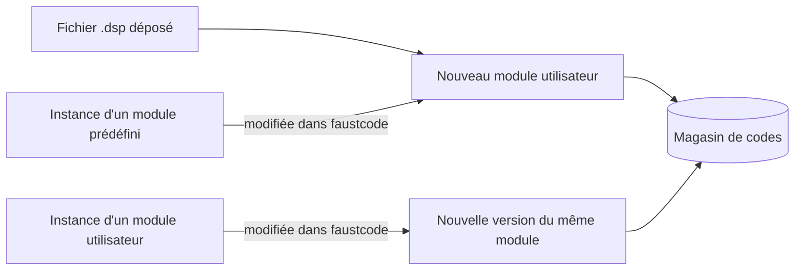

::: toc+
- **Objet** — ce qui manque aujourd'hui et ce que la notion de document doit apporter.
- **Ce que font les trois projets** — faustdaw, markpage, faustcode : ce qu'on reprend de chacun.
- **La thèse** — trois notions et une règle : des documents légers qui référencent un magasin de codes immuables.
- **Le code** — identité par le contenu, immuabilité, enveloppe dérivée.
- **La bibliothèque de modules** — modules prédéfinis et modules utilisateur, versions, instances épinglées.
- **La préservation** — un document se rouvre et sonne à l'identique, quelles que soient les évolutions du logiciel, de sa bibliothèque et des bibliothèques Faust.
- **Le document** — contenu, copie validée et copie de travail, frontière de l'annulation.
- **Le stockage** — disposition dans OPFS, index, persistance, collecte des codes inutilisés.
- **Les surfaces** — menu Fichier, Ouvrir, bibliothèque, indicateur de modification.
- **L'échange** — fichier exporté autonome, import, exemples, anciens formats.
- **Le partage** — entre documents, entre outils de la même origine.
- **Robustesse** — onglets multiples, quota, migration de l'existant.
- **Décisions et points ouverts** — ce que cette spécification tranche et ce qu'elle laisse ouvert.
- **Phases** — un découpage en étapes livrables, chacune utile seule.
:::

# Objet \label{sec:objet}

Aujourd'hui, faustmodular n'a pas de notion de document. La scène vit en mémoire ; on la sauve à la main dans le stockage local (clé `FaustPlayground`), en fichier ou sur Google Drive ; ouvrir un patch remplace la scène après confirmation. Les modules n'ont pas d'existence propre en dehors de la scène : un module dont on a modifié le code dans faustcode, ou un fichier `.dsp` déposé sur la scène, n'est réutilisable qu'en recopiant son code.

Nous voulons :

- un **document** qui décrit toute la scène, **persistant dans le navigateur**, sans risque de perte ni question « enregistrer avant de fermer ? » ;
- plusieurs documents, entre lesquels on passe comme entre fichiers ;
- une **bibliothèque** qui distingue les **modules prédéfinis**, livrés avec le logiciel, et les **modules utilisateur** : tout fichier source déposé sur la scène et tout module dont on modifie le code en deviennent un ;
- un **partage** simple des modules entre documents, et, à terme, entre les outils de la même origine (faustcode, faustdaw).

# Ce que font les trois projets \label{sec:existant}

Les trois projets répondent chacun à une partie de la question ; leurs choix sont compatibles.

```csv "Ce que chaque projet apporte" \label{tab:existant}
Aspect,faustdaw (spécifié),markpage (implémenté),faustcode (implémenté)
Unité,document de session (JSON) + ressources audio,bundle content.md + assets/,session = un code
Identité,sessionId opaque ; nom éditable unique ; révision = empreinte du contenu,uuid ; nom affiché dans index.json,sha1 du code
Ressources,immuables ; une compilation = une nouvelle ressource,magasin interne par SHA ; dédoublonnage invisible,le code lui-même ; jamais modifié
Persistance,copie de travail locale ; autosave,OPFS ; copie validée + copie de travail ; Save / Revert,OPFS ; brouillons de l'éditeur
Plusieurs documents,workspace des sessions ouvertes,bibliothèque + Open… + Files… + corbeille,liste chronologique des sessions
Onglets multiples,un onglet écrit (lease) ; les autres suivent,détecter + avertir (lecture seule),BroadcastChannel entre onglets
Échange,export .zip (JSON + ressources),bundle .zip ; lien pour les petits documents,lien ?code= compressé
Annulation,porte sur le document,par document,—
```

Nous reprenons :

- de **faustdaw**, la distinction **document / ressources / état d'exécution**, et l'annulation qui porte sur le document seul ;
- de **markpage**, le stockage **OPFS**, la **copie validée et la copie de travail** (Save et Revert sans risque), le **magasin interne par empreinte** qui ne fuit pas dans le modèle de l'utilisateur, la corbeille et la migration prudente ;
- de **faustcode**, l'**identité d'un code par son contenu** et la règle « éditer, c'est créer un nouveau code ».

# La thèse \label{sec:these}

::: important [La règle]
**Les documents référencent, le magasin conserve.** Un code Faust est immuable et identifié par son contenu ; la bibliothèque nomme des codes ; un document place des instances qui pointent vers des codes.
:::

Trois notions suffisent.

::: definition [Code]
Un texte source Faust, tel que l'utilisateur l'écrit (sans l'enveloppe ajoutée par faustmodular, \ref{sec:code}). Il est identifié par l'empreinte SHA-1 de son contenu et n'est jamais modifié : modifier un code, c'est créer un nouveau code.
:::

::: definition [Module de bibliothèque]
Un nom donné à un code et à la suite de ses versions. Un module est **prédéfini** (livré avec le logiciel, en lecture seule) ou **utilisateur** (créé par l'utilisateur, renommable, supprimable). Ce statut n'est jamais enregistré : il se **déduit du contenu**. Un code que la bibliothèque livrée contient est prédéfini ; tout autre code relève d'un module utilisateur (\ref{sec:preservation}).
:::

::: definition [Document]
La description complète d'une scène : ses instances de modules, leurs positions, réglages et modulations, et les connexions. Chaque instance pointe vers une version précise d'un code.
:::

Tout le reste en découle :

- deux documents qui utilisent le même module partagent le même code ;
- copier une instance d'un document à l'autre ne copie qu'une référence ;
- un code reste dans le magasin tant que quelqu'un le référence (\ref{sec:collecte}) ;
- exporter un document, c'est l'accompagner des codes qu'il référence (\ref{sec:echange}).

```adt
Document ::= Doc(id, name, faust, generator, instances, connections, io)
Faust    ::= Env(libfaust, libraries)                                  (* libraries : empreinte d'un environnement de bibliothèques *)
Instance ::= Inst(id, name, origin, code, x, y, params, modulations)   (* code : empreinte d'une version *)
Origin   ::= Builtin(path)                                             (* provenance, indicative : jamais un statut *)
           | User(moduleId)
Module   ::= BuiltinModule(path, name, category, code)                 (* livré avec le logiciel *)
           | UserModule(moduleId, name, category, versions)            (* versions : empreintes, de la plus ancienne à la plus récente *)
Code     ::= Text(sha1, source)                                        (* immuable *)
```

Le statut d'une instance est une fonction de son code, recalculée à chaque ouverture :

```text
statut(i) = prédéfini   si i.code ∈ { m.code | m ∈ bibliothèque livrée }
          | utilisateur sinon
```

# Le code \label{sec:code}

- **Identité.** L'empreinte est le SHA-1 du texte en UTF-8, fins de ligne normalisées en `\n`. C'est l'identité que faustcode utilise déjà pour ses sessions (\ref{sec:partage}).
- **Immuabilité.** Un code stocké n'est jamais réécrit. Une édition dans faustcode, un fichier déposé, un import produisent un nouveau code (ou retrouvent un code identique déjà présent : même empreinte, aucun doublon).
- **L'enveloppe est dérivée.** faustmodular compile chaque instance dans un groupe à son nom, `process = vgroup("<nom>", environment{ … }.process);`, qui donne leurs adresses aux paramètres. Cette enveloppe dépend de l'instance, pas du code : le magasin garde le code de l'utilisateur, et l'enveloppe est construite à la compilation (`src/model/ModuleCode.ts`).
- **Le code compilé est un cache.** Une factory compilée dépend du code effectif (code, enveloppe, modulations), des options de compilation et de la version de libfaust. Elle peut être mise en cache sous cette clé, mais elle ne fait partie ni du document ni du magasin.

# La bibliothèque de modules \label{sec:bibliotheque}

La bibliothèque a deux rayons.

- **Modules prédéfinis.** Ceux de `public/faust-modules` (index par catégories). Ils sont livrés et versionnés avec le logiciel, en lecture seule. Leur code entre dans le magasin à leur première utilisation. L'index livré donne, pour chaque module, l'empreinte de son code : c'est lui qui décide du statut des instances (\ref{sec:preservation}).
- **Modules utilisateur.** Un module utilisateur a un identifiant opaque (uuid), un nom éditable, une catégorie facultative et la liste de ses versions.

Un module utilisateur est créé :

1. quand on **dépose un fichier source** sur la scène : un module utilisateur nommé d'après le fichier (ou d'après `declare name`), dont la première version est ce code ;
2. quand on **modifie le code** d'une instance dans faustcode :
   - si l'instance provient d'un module **prédéfini**, un nouveau module utilisateur est créé, nommé comme le module d'origine, avec le nouveau code comme première version ;
   - si l'instance provient déjà d'un module **utilisateur**, le nouveau code est ajouté comme nouvelle version de ce module.

Placer un module prédéfini sur la scène ne crée **pas** de module utilisateur : seule une modification ou un dépôt en crée un.



**Instances épinglées.** Une instance pointe vers une version précise (une empreinte), pas vers « la dernière version » de son module. Ainsi un document se rouvre à l'identique, et l'annulation reste exacte. Quand le module a une version plus récente, la bibliothèque le signale sur l'instance, et une action **Mettre à jour** la fait passer à la dernière version (une modification ordinaire, donc annulable). L'instance que l'on vient de modifier dans faustcode passe, elle, directement à la nouvelle version.

**Gérer les modules utilisateur** : renommer, changer de catégorie, supprimer (vers la corbeille), voir les versions et les documents qui les utilisent. Supprimer un module utilisateur ne casse aucun document : ses instances gardent leur code, puisqu'elles pointent vers des empreintes.

# La préservation \label{sec:preservation}

::: important [Le principe]
Un document se rouvre **et sonne** à l'identique dans toute version ultérieure de faustmodular. Rien de ce dont il dépend ne peut changer sous lui ; toute évolution est proposée, jamais subie, et elle s'annule comme une modification ordinaire.
:::

C'est le principe que Faust s'applique depuis l'origine : un programme reste compilable et son sens ne dépend pas de l'outil qui le lit. Le son d'une instance dépend de quatre choses ; chacune reçoit une règle.

| Dépendance | Qui la fait évoluer | Règle |
| :-- | :-- | :-- |
| le code de l'instance | l'utilisateur | immuable, référencé par empreinte (\ref{sec:code}) |
| le module prédéfini dont elle provient | les versions de faustmodular | statut déduit du contenu (\ref{sec:statut}) |
| les bibliothèques Faust (`stdfaust.lib`…) | les versions des bibliothèques | environnement épinglé (\ref{sec:environnement}) |
| le code ajouté par faustmodular (enveloppe, circuits de modulation) | les versions de faustmodular | générateur versionné (\ref{sec:generateur}) |

## Le statut se déduit du contenu \label{sec:statut}

Un module prédéfini peut évoluer d'une version de faustmodular à l'autre. Un document enregistré avant cette évolution garde l'ancien code : il ne doit ni changer de son, ni prétendre utiliser un module qu'il n'utilise plus.

**Règle.** À l'ouverture d'un document, chaque instance est recherchée par l'empreinte de son code dans l'index de la bibliothèque livrée :

- si l'empreinte y figure, l'instance est une instance de ce module **prédéfini** (même s'il a été déplacé ou renommé dans la bibliothèque) ;
- sinon, l'instance relève d'un module **utilisateur** : celui dont les versions contiennent cette empreinte s'il existe (de préférence celui que désigne `origin`), sinon un module utilisateur est **créé automatiquement**, nommé comme le module d'origine et dont la seule version est ce code.

Conséquences :

- un module prédéfini qui a évolué devient, dans les anciens documents, un module utilisateur qui conserve l'ancien code : **la scène sonne comme avant** ;
- la création est faite une fois par empreinte : plusieurs instances, ou plusieurs documents, qui utilisent le même ancien code partagent le même module utilisateur ;
- l'ouverture ne modifie pas le document : seule la bibliothèque de l'utilisateur s'enrichit. Le champ `origin` est une provenance (pour l'affichage et pour proposer une mise à jour), jamais un statut ;
- un code utilisateur identique à un module prédéfini *est* ce module : même contenu, même chose.

**Historique de la bibliothèque.** Le script de construction tient à jour un fichier `library-history.json`, en ajout seul, qui associe à chaque empreinte passée d'un module prédéfini son chemin et les versions de faustmodular qui l'ont livrée. Grâce à lui, un module utilisateur créé par la règle peut être présenté comme « SOscillator, version livrée jusqu'à faustmodular 2.11 », et **Mettre à jour** peut proposer la version actuelle (une modification ordinaire, annulable). Sans cet historique, la règle fonctionne, avec moins d'informations.

## Les bibliothèques Faust sont épinglées \label{sec:environnement}

Un code qui écrit `import("stdfaust.lib")` n'est pas autonome : si `os.osc` change dans une version ultérieure des bibliothèques, la même empreinte ne produit plus le même son, ou ne compile plus.

**Le code expansé n'est pas la solution retenue.** Faust sait produire une version autonome d'un programme (`faust -e`, `expandDSP` dans faustwasm), mais elle est illisible. Le magasin garde le code tel que l'utilisateur l'écrit ; l'expansion peut servir d'outil de diagnostic (comparer l'expansion d'un code avant et après une mise à jour des bibliothèques), jamais de forme stockée.

**La solution : épingler, sans dissoudre.** On applique aux bibliothèques la thèse du document : les bibliothèques sont des contenus immuables, identifiés par empreinte, que les documents référencent.

- Un **environnement de bibliothèques** est un manifeste qui associe à chaque fichier `.lib` le SHA-1 de son contenu (l'équivalent d'un *lockfile*). Il est lui-même identifié par l'empreinte de son manifeste.
- Le magasin garde les fichiers `.lib` par empreinte. D'une version des bibliothèques à l'autre, peu de fichiers changent : conserver plusieurs environnements coûte peu.
- Le document enregistre son environnement (`faust.libraries`) et la version de libfaust (`faust.libfaust`). Un nouveau document reçoit l'environnement livré avec le logiciel.
- À la compilation, faustmodular écrit les fichiers exacts de l'environnement dans le système de fichiers virtuel de libfaust (`fs()` de faustwasm), à la place des bibliothèques livrées. Le code d'origine, lisible, recompile à l'identique.
- **Mettre à jour les bibliothèques** fait passer le document à l'environnement livré : une action explicite et annulable, qui peut s'accompagner du diagnostic par expansion (quelles instances changent de sens).

**Références explicites.** Le registre de paquets Faust (`grame-cncm/faustregistry`, GSoC 2024) en est la forme explicite : un code qui importe `pkg:faust/faust/stdfaust.lib@1.0.0` fixe toute la fermeture transitive de ses dépendances, car dans le registre chaque bibliothèque importe les autres à version exacte (`library("pkg:faust/faust/maths.lib@2.8.0")`). Un tel code est préservé par son texte même. faustmodular résout ces références lui-même (la prise en charge de `pkg:` par libfaust dans le navigateur n'est pas vérifiée) : il télécharge les fichiers, les vérifie par empreinte, les range dans le magasin et les ajoute à l'environnement. L'empreinte est indispensable : le registre ne garantit l'immuabilité d'une version que par convention.

## Le code généré est versionné \label{sec:generateur}

faustmodular ajoute du code à celui de l'utilisateur : l'enveloppe `vgroup` (\ref{sec:code}) et les circuits de modulation (modes, profondeurs). Le document n'enregistre que des réglages (mode, profondeur, bornes) ; c'est le **générateur** qui en tire le circuit.

**Règle.** Le document enregistre la version du générateur (`generator`). Toute évolution du générateur qui change le son d'un document existant crée une nouvelle version ; faustmodular sait produire les versions antérieures, ou, à défaut, signale le document et propose explicitement la migration.

## Ce qui reste hors d'atteinte

La version de libfaust elle-même : le navigateur ne peut pas embarquer tous les compilateurs passés. Elle est enregistrée (`faust.libfaust`) pour le diagnostic ; ses évolutions qui changent la sémantique sont rares et documentées par le projet Faust.

# Le document \label{sec:document}

## Contenu \label{sec:contenu}

Un document contient ce que l'utilisateur crée et peut annuler :

- son nom ;
- son environnement Faust : version de libfaust et empreinte de l'environnement de bibliothèques, et la version du générateur (\ref{sec:preservation}) ;
- les instances : identifiant, nom (celui du groupe Faust), provenance, empreinte du code, position, valeurs des paramètres, réglages d'accéléromètre, modulations (widget, mode, bornes) ;
- les positions des modules d'entrée et de sortie physiques ;
- les connexions.

Il ne contient pas :

- la sélection, l'état du menu, l'historique d'annulation (version 1, \ref{sec:decisions}) ;
- le nombre de canaux de l'entrée physique, qui dépend du matériel ;
- les codes eux-mêmes, ni les factories compilées : il les référence.

Ce contenu est exactement l'état qu'utilise déjà l'annulation (`Scene.captureSnapshot`), à la différence près que les codes y sont remplacés par leurs empreintes : **la frontière de l'annulation est le document**, comme dans faustdaw.

```json "Document, format version 4"
{
  "format": "faustmodular-document",
  "version": 4,
  "name": "Vibrato",
  "faust": { "libfaust": "2.90.19", "libraries": "9b04…" },
  "generator": 1,
  "instances": [
    {
      "id": "1", "name": "SOscillator",
      "origin": { "kind": "builtin", "path": "generators/SOscillator.dsp" },
      "code": "3f1c…", "x": 480, "y": 120,
      "params": { "/SOscillator/Frequency": 300 },
      "acc": [], "modulations": [ { "widget": "/SOscillator/Frequency", "mode": "modulate", "…": "…" } ]
    }
  ],
  "io": { "input": { "x": 10, "y": 425 }, "output": { "x": 1302, "y": 425 } },
  "connections": [ "2:0>1:1", "1:0>output:0" ]
}
```

## Copie validée et copie de travail \label{sec:save}

Chaque document a deux états, comme dans markpage :

- la **copie validée**, le dernier état enregistré ;
- la **copie de travail**, l'état courant, **sauvegardé automatiquement** à chaque étape de l'historique (après 400 ms de calme).

| Geste | Effet |
| :-- | :-- |
| Autosave | écrit la copie de travail, jamais la copie validée |
| Enregistrer (Cmd/Ctrl-S) | copie validée ← copie de travail |
| Revenir à la version enregistrée | la copie de travail est abandonnée |
| Enregistrer sous… | la copie de travail devient un nouveau document ; l'original redevient propre |

Le document est **modifié** quand la copie de travail diffère de la copie validée : un point (●) le signale à côté de son nom. Comme la copie de travail est persistée, on peut fermer l'onglet et revenir : rien n'est perdu, et la question « enregistrer avant de fermer ? » disparaît. La confirmation actuelle avant de remplacer une scène modifiée devient inutile : ouvrir un autre document ne détruit rien.

## Identité \label{sec:identite}

Un document a un **identifiant** opaque (uuid), stable, et un **nom** éditable. Les noms sont uniques dans le navigateur : en cas de collision, un suffixe ` 2`, ` 3`… est ajouté (règle de faustdaw).

# Le stockage \label{sec:stockage}

Le stockage repose sur l'**Origin Private File System** (OPFS), comme markpage et faustcode.

```tree "Disposition dans OPFS"
faustmodular/
  index.json            documents et modules utilisateur : identifiants, noms, dates, états
  documents/
    <uuid>/
      committed.json     copie validée
      working.json       copie de travail (absente si le document est propre)
  modules/
    <uuid>.json          module utilisateur : nom, catégorie, versions
  codes/
    <sha1>.dsp           magasin de codes, partagé
  libraries/
    <sha1>.lib           fichiers de bibliothèques Faust, par empreinte
  environments/
    <sha1>.json          environnements : nom de fichier .lib → empreinte
  trash/                 documents et modules supprimés, restaurables
  cache/                 factories compilées (reconstructibles)
```

- **Persistance.** L'application demande `navigator.storage.persist()` pour éviter l'éviction silencieuse, et affiche l'espace utilisé (`navigator.storage.estimate()`).
- **Écriture sûre.** Un code est écrit avant tout document qui le référence ; `index.json` est réécrit en dernier.

## Collecte des codes inutilisés \label{sec:collecte}

Un code est **vivant** s'il est référencé par :

- une version d'un module utilisateur (corbeille comprise) ;
- la copie validée ou la copie de travail d'un document (corbeille comprise) ;
- l'historique d'annulation du document ouvert (en mémoire).

La collecte marque les codes vivants à partir de ces racines et supprime les autres. Elle a lieu au démarrage et quand on vide la corbeille, jamais pendant une restauration de l'historique. Les codes des modules prédéfinis sont toujours reconstructibles et peuvent être collectés comme les autres.

La même règle vaut pour les bibliothèques : un environnement est vivant s'il est référencé par un document vivant (ou par l'historique ouvert), et un fichier `.lib` s'il appartient à un environnement vivant. L'environnement livré avec le logiciel est toujours reconstructible.

# Les surfaces \label{sec:surfaces}

Le menu actuel (Library, Load, Edit, Save, Export) évolue ainsi :

```
Fichier ▾
 Nouveau document           Cmd/Ctrl-N
 Ouvrir…                    Cmd/Ctrl-O      liste des documents, recherche
 ──────────────
 Enregistrer                Cmd/Ctrl-S
 Enregistrer sous…
 Revenir à la version enregistrée
 ──────────────
 Renommer… · Dupliquer · Supprimer
 Exporter… · Importer…
 Nouveau depuis un exemple ▸
```

- Le **nom du document** est affiché dans l'en-tête, éditable par un clic, avec le point de modification.
- La **bibliothèque** garde ses colonnes de modules prédéfinis et ajoute une colonne **Mes modules** (modules utilisateur), avec renommer, catégorie, supprimer, versions.
- **Export** garde l'export en programme Faust et les cibles du service de compilation ; l'export du document rejoint le menu Fichier.

# L'échange \label{sec:echange}

- **Exporter un document** produit un fichier JSON **autonome** : le document et les codes qu'il référence, ainsi que les métadonnées des modules utilisateur concernés (nom, catégorie), et son environnement de bibliothèques (manifeste et fichiers `.lib`, \ref{sec:environnement}). Les codes et les bibliothèques étant du texte, un fichier unique suffit, sans archive.
- **Importer** ajoute les codes et les bibliothèques au magasin (sans doublon, grâce aux empreintes), applique la règle du statut (\ref{sec:statut}) : chaque code absent de la bibliothèque livrée rejoint le module utilisateur qui le contient, ou en crée un. Le document s'ouvre comme un **nouveau** document : l'import n'écrase jamais un document existant.
- **Exemples.** Les exemples du menu actuel deviennent « Nouveau depuis un exemple » : chacun crée un nouveau document.
- **Anciens formats.** Les fichiers des versions 1, 2 et 3 s'importent de la même façon : chaque code est extrait (sans son enveloppe) vers le magasin, et la règle du statut s'applique. Ces fichiers ne disent pas avec quelles bibliothèques ils ont été écrits : ils reçoivent l'environnement livré.
- **Partage par lien** (plus tard) : un document compressé dans l'URL, comme les liens de faustcode, plafonné en taille ; au-delà, le fichier exporté.

# Le partage \label{sec:partage}

- **Entre documents.** Les modules utilisateur appartiennent au navigateur, pas à un document : tous les documents les voient dans la bibliothèque. Copier des instances d'un document à l'autre (plus tard) ne copie que des références.
- **Entre outils de la même origine.** faustmodular, faustcode et faustdaw, hébergés sous `orlarey.github.io`, partagent l'OPFS de cette origine. faustcode identifie déjà ses sessions par le SHA-1 du code : le magasin de codes peut devenir **commun**. Une édition dans faustcode n'aurait alors plus besoin de transporter le code par message, seulement son empreinte. C'est la « publication » du document de conception sur les applis coopérantes. Ce partage est une perspective : la version 1 garde son propre magasin, avec la même convention d'empreinte pour rendre la convergence triviale.

## Perspective : fauststore \label{sec:fauststore}

À plus long terme, le magasin local appelle un **magasin public** de code Faust, une sorte de GitHub spécialisé : **fauststore**. On y trouverait des codes **versionnés**, **décrits**, **catégorisés**, **classés** et éventuellement **évalués**.

La thèse de ce document le prépare sans rien imposer :

- les codes sont déjà identifiés par leur contenu : un code reste le même dans le magasin local et dans fauststore, sans doublon ;
- un module utilisateur, avec la suite de ses versions, est l'unité naturelle à **publier** ; les métadonnées `declare` de Faust (nom, auteur, licence, version, description) en fournissent une première description ;
- un module récupéré de fauststore se comporte comme un module de bibliothèque : ses instances sont attachées à une version précise, et « Mettre à jour » propose les versions publiées depuis.

# Robustesse \label{sec:robustesse}

- **Onglets multiples.** Deux onglets sur le même document risquent de s'écraser. Défaut retenu, comme markpage : **détecter et avertir**. Le second onglet ouvre le document en lecture seule, par `BroadcastChannel`. Plus tard : un seul onglet écrit, les autres suivent (le *lease* de faustdaw).
- **Quota dépassé.** L'erreur d'écriture est interceptée et signalée, avec l'espace utilisé et les moyens d'en libérer (vider la corbeille).
- **Migration de l'existant.** Au premier démarrage, de façon idempotente :
  1. chaque scène de la clé `FaustPlayground` du stockage local devient un document (copie validée = la scène) ;
  2. ses codes partent dans le magasin, la règle du statut s'applique (\ref{sec:statut}) et ses documents reçoivent l'environnement livré ;
  3. la migration est marquée faite ; l'ancienne clé est conservée en filet de sécurité, puis effacée après au moins 7 jours **et** 2 démarrages réussis (règle de markpage).
- **Aucun abandon silencieux.** Ce qui ne peut être importé ou migré (un code qui ne compile plus) est signalé, jamais perdu sans trace.

# Décisions et points ouverts \label{sec:decisions}

Décisions prises par cette spécification, validées le 1er novembre 2026 :

1. Un code est immuable et identifié par le SHA-1 de son texte ; le magasin garde le code de l'utilisateur, sans enveloppe.
2. Une instance est épinglée à une version ; « Mettre à jour » est explicite et annulable.
3. Placer un module prédéfini ne crée pas de module utilisateur ; déposer un fichier ou modifier un code en crée un (ou une nouvelle version).
4. Le statut prédéfini ou utilisateur se déduit du contenu, à chaque ouverture ; un module prédéfini qui a évolué devient, dans les anciens documents, un module utilisateur qui garde l'ancien code.
5. Les bibliothèques Faust sont épinglées par document (environnement identifié par empreinte) ; le code expansé n'est pas stocké.
6. Le générateur de faustmodular (enveloppe, modulations) est versionné dans le document.
7. Copie validée et copie de travail, sauvegarde automatique de la copie de travail ; ouvrir ou importer ne remplace jamais un document.
8. Stockage OPFS ; collecte des codes et des bibliothèques par marquage depuis les modules, les documents et l'historique ouvert.
9. Fichier exporté autonome, en JSON, format version 4.
10. Un document par onglet : Ouvrir remplace le document affiché, l'autre garde sa copie de travail ; deux documents à la fois, ce sont deux onglets. Plusieurs documents dans un même onglet (le *workspace* de faustdaw) reste possible plus tard, sans changer le format.

Points ouverts :

- **Persister l'historique d'annulation** avec la copie de travail, comme le prévoit faustdaw, pour le retrouver après un rechargement.
- **Préréglages** de modules : enregistrer des jeux de paramètres selon le même principe (contenu identifié par empreinte), comme les préréglages de faustdaw.
- **Synchronisation** avec Google Drive : la conserver comme cible d'export, ou la retirer.
- **Magasin commun** avec faustcode et faustdaw (\ref{sec:partage}).
- **fauststore**, magasin public de code Faust (\ref{sec:fauststore}) : pas pour tout de suite, mais la convention d'empreinte et les modules utilisateur versionnés le préparent.
- **Système de paquets immuables.** Reconstituer la spécification du gestionnaire de paquets Faust (GSoC 2024) et y ajouter ce qui manque au registre actuel : une empreinte publiée pour chaque version, et l'interdiction de réécrire une version publiée. fauststore pourrait en être le registre.
- **Taille de l'export autonome** : l'environnement complet pèse environ 2 Mo de texte. N'y mettre que les fichiers effectivement lus à la compilation demande de savoir les obtenir de libfaust (à vérifier).

# Phases \label{sec:phases}

Chaque phase est utile seule.

::: note [État]
Phase 2 livrée dans faustmodular 3.2.0 : le statut est calculé à partir du contenu seul (le champ `origin` n'est pas encore enregistré ; une empreinte présente dans plusieurs modules utilisateur désigne le plus récemment modifié) ; les catégories des modules utilisateur et la liste détaillée de leurs versions restent à faire (le nombre de versions est indiqué). Phase 1 livrée dans faustmodular 3.0.0. La corbeille est un état de l'index (`trashed`) plutôt qu'un dossier `trash/` ; un document migré du stockage local garde son ancien fichier (`legacy`) jusqu'à sa première ouverture ; un document vierge que personne n'a utilisé est remplacé, plutôt que gardé, par un nouveau document ou un fichier ouvert.
:::

1. **Documents.** Magasin de codes, documents en OPFS (copie validée et de travail), autosave, Nouveau, Ouvrir, Enregistrer, Revenir, Renommer, Dupliquer, Supprimer, corbeille ; migration du stockage local. La bibliothèque reste celle d'aujourd'hui. Le document enregistre déjà `faust` et `generator`, pour que les documents créés dès cette phase soient préservables.
2. **Modules utilisateur.** Création au dépôt d'un fichier et à la modification dans faustcode, versions, instances épinglées et mise à jour, colonne Mes modules ; index des empreintes de la bibliothèque, `library-history.json` et règle du statut.
3. **Échange.** Export et import du document autonome (version 4), import des anciens formats, exemples comme modèles.
4. **Bibliothèques épinglées.** Environnements et fichiers `.lib` dans le magasin, compilation dans l'environnement du document, « Mettre à jour les bibliothèques » avec diagnostic par expansion, résolution des références `pkg:`.
5. **Confort.** Lecture seule du second onglet, cache des factories compilées, espace utilisé, persistance de l'historique.
6. **Convergence.** Magasin commun avec faustcode, puis faustdaw.
