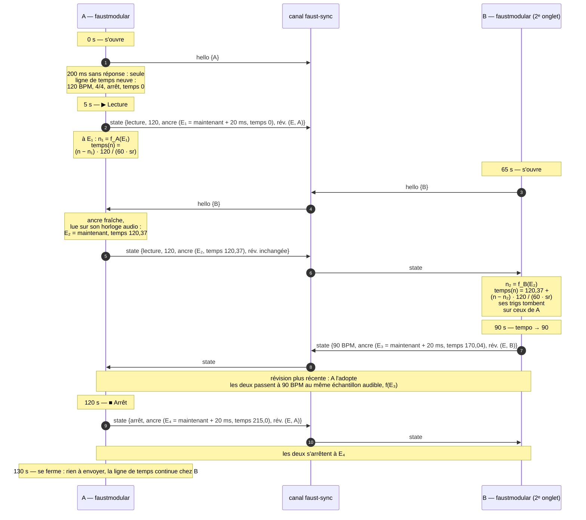

# faust-sync — une horloge musicale commune aux applications Faust

*Spécification, version 0.2 (proposition, 2026-11-05). La 0.1 comptait le temps musical en temps du système ; la 0.2
le compte en échantillons audio, le temps du système ne servant plus que de passerelle (§ 2, § 7). Réalisée dans
faustmodular 3.43.0 (§ 8.1, § 12).*

## 1. Objet

Partager un **tempo**, une **mesure** et un **transport** (lecture, arrêt, position) entre les applications Faust
ouvertes dans le même navigateur : faustmodular, faustcode, faustdaw, et les suivantes. Ainsi :

- deux faustmodular, ou un faustmodular et un faustcode, jouent en mesure ;
- n'importe quelle application peut lancer la lecture, l'arrêter ou changer le tempo, et les autres suivent ;
- une application ouverte en cours de route se cale sur les autres.

Elle fonctionne **sans appareil extérieur**, et seule : une application sans partenaire a sa propre ligne de temps.
Une horloge MIDI extérieure peut la piloter (§ 9), sans être nécessaire.

### 1.1 Cas d'usage principal, et critère

Le cas d'usage principal est **un seul navigateur, une seule carte son**. La priorité est la synchronisation des
applications entre elles.

> **Critère d'acceptation.** Deux faustmodular ouverts dans deux onglets, chacun avec un module d'horloge synchronisée
> qui déclenche un son bref sur chaque double croche : les déclenchements des deux applications sortent du
> haut-parleur **au même instant**, à moins de 1 ms près, et le restent pendant une heure de lecture ; y compris
> quand le second onglet est ouvert alors que le premier joue déjà, et après des changements de tempo.

La mesure : l'un des onglets à gauche, l'autre à droite, la sortie enregistrée (une boucle audio, par exemple
BlackHole sur macOS) ; on mesure l'écart des attaques entre les deux canaux (§ 10).

Hors du champ de cette version : la synchronisation entre ordinateurs (il faudrait un serveur, WebRTC, ou un pont
vers Ableton Link) et l'émission d'une horloge MIDI vers des appareils (§ 11).

## 2. Principe

1. **Une règle, pas des impulsions.** On ne s'envoie pas des impulsions (« un temps maintenant ») : chacune hériterait
   du retard variable de son message. On partage la règle qui donne la position musicale :

   > à l'instant *t₀*, on était au temps musical *b₀*, et l'on avance à *T* temps par minute.

   Un message ne change que la règle, et seulement quand elle change (tempo, lecture, arrêt, position).

2. **Le temps musical avance en échantillons.** Dans chaque application, un nœud audio compte les échantillons de son
   `AudioContext` et en déduit la position musicale à chaque échantillon. Sur une seule carte son, tous les onglets sont
   cadencés par la même horloge matérielle : leurs échantillons avancent exactement au même rythme, sans dérive.

3. **Le temps commun du navigateur ne sert que de passerelle.** Deux applications n'ont pas de compteur d'échantillons
   commun (chacune a son contexte, parti à un autre instant, parfois à une autre fréquence). Une ancre voyage donc en
   temps commun (§ 3), et chaque application la traduit, à son arrivée, en numéro d'échantillon de son contexte (§ 7.1).

4. **Une ancre fraîche, un effet différé.** Une réponse porte toujours la position *à l'instant de la réponse* (pas
   l'ancre d'origine, qui pourrait dater d'une heure) ; un changement prend effet **20 ms après** avoir été décidé, pour
   que chaque application le reçoive avant et bascule au même échantillon audible.

## 3. Le temps commun

Le temps **epoch** du navigateur, en millisecondes, à haute résolution :

```js
const now = () => performance.timeOrigin + performance.now();
```

Chaque onglet a son `timeOrigin` (l'instant où il s'est ouvert), mais la somme est une même horloge pour tous les
onglets du navigateur (mesuré : § 10).

## 4. La ligne de temps

```ts
interface Timeline {
    tempo: number;              // temps (noires) par minute, de 20 à 999
    meter: number;              // temps par mesure (4 : 4/4)
    playing: boolean;
    anchor: { time: number; beat: number };     // au temps commun `time` (ms), la position était (ou sera) `beat`
    revision: { time: number; origin: string }; // le changement qui l'a produite : quand, et par qui
}
```

La position au temps commun *t* (dans les messages) :

```
beat(t) = playing ? anchor.beat + (t − anchor.time) × tempo / 60000  :  anchor.beat
```

Le temps 0 est le premier temps de la première mesure ; *mesure:temps* = `floor(beat / meter) + 1 : floor(beat mod meter) + 1`.
Une ligne de temps neuve : `{ tempo: 120, meter: 4, playing: false, anchor: { time: now(), beat: 0 } }`.

## 5. Les opérations

Une opération décidée à l'instant `t = now()` prend effet à `e = t + L`, **L = 20 ms** (§ 2.4). La nouvelle ligne de
temps est continue (la position ne saute pas, sauf si on le demande), et sa révision est `{ time: t, origin }` :

| Opération | Nouvelle ligne de temps |
|---|---|
| `setTempo(T)` | `anchor = { e, beat(e) }`, `tempo = T` |
| `play()` | `anchor = { e, beat(e) }`, `playing = true` (repart d'où l'arrêt l'a laissée) |
| `play({ fromStart: true })` | `anchor = { e, 0 }`, `playing = true` |
| `stop()` | `anchor = { e, beat(e) }`, `playing = false` |
| `locate(b)` | `anchor = { e, b }` |
| `setMeter(m)` | `meter = m` |

Une application qui lance la lecture alors que d'autres jouent déjà ne crée rien : elle suit la ligne de temps.

## 6. Le protocole

### 6.1 Le canal et les messages

Un `BroadcastChannel("faust-sync")` : il relie les onglets et fenêtres de la **même origine** dans le même navigateur
(`https://orlarey.github.io` pour faustcode, faustmodular et faustdaw).

```ts
type SyncMessage =
    | { protocol: "faust-sync"; version: 1; type: "hello"; origin: string }                       // j'arrive
    | { protocol: "faust-sync"; version: 1; type: "state"; origin: string; timeline: Timeline }   // la ligne de temps
```

`origin` : le nom de l'application et un identifiant tiré à son ouverture (`"faustmodular:" + crypto.randomUUID()`).
Un message d'une autre `version` est ignoré.

### 6.2 Les règles

1. **À l'ouverture**, une application envoie `hello`. Chaque autre application répond par sa ligne de temps (`state`),
   avec une **ancre fraîche** : `anchor = { now(), beat }`, *beat* lu sur sa propre horloge audio (§ 7.2), et la
   **révision inchangée** (c'est la même règle, réancrée). Sans réponse en 200 ms, l'application est seule.
2. **À chaque opération**, l'application calcule la nouvelle ligne de temps (§ 5), l'adopte et l'envoie.
3. **À la réception** d'un `state`, une application l'adopte si sa révision est plus récente : temps plus grand, puis,
   à égalité, `origin` plus grand (deux changements simultanés finissent sur la même ligne de temps partout). Une
   réponse à un `hello` (même révision) est adoptée par l'application qui arrive, et ignorée par les autres.
4. **Pas de maître** : le dernier changement l'emporte, d'où qu'il vienne. Une application qui se ferme ne change rien.

### 6.3 Le déroulement : deux applications, l'une ouverte avant l'autre



*E* : temps commun (ms) ; *n* : numéro d'échantillon du contexte de chaque application ; *f_X* : la traduction du temps
commun en échantillons de l'application X (§ 7.1). Les deux applications ont chacune leur *n*, mais le même temps
musical à chaque instant audible.

### 6.4 Les autres cas

- **B s'ouvre alors que tout est à l'arrêt** : A répond par sa ligne de temps à l'arrêt ; B affiche le même tempo et la
  même position.
- **A et B s'ouvrent en même temps** : chacune se croit seule, puis reçoit le `hello` de l'autre et y répond ; la
  révision la plus récente l'emporte (et le contenu est le même). Elles convergent en quelques millisecondes.
- **Un message arrive après l'instant d'effet** (onglet très chargé, plus de 20 ms) : l'application l'applique à
  l'échantillon courant, en rattrapant la position (un saut de la durée du retard) ; c'est le seul cas de saut.

## 7. Dans chaque application

### 7.1 Du temps commun aux échantillons

`getOutputTimestamp()` dit **quel instant du contexte sort du haut-parleur** à quel instant de `performance.now()` :
la latence de sortie est comprise, et deux applications qui visent le même temps commun visent le même instant
audible.

```js
const ts = context.getOutputTimestamp();
const frameOf = (E) => context.sampleRate * (ts.contextTime + (E - performance.timeOrigin - ts.performanceTime) / 1000);
```

La traduction n'est faite **qu'à l'arrivée d'une ligne de temps** : l'ancre devient un numéro d'échantillon
`anchorFrame`, et la suite est comptée en échantillons. Une traduction est entachée de l'imprécision de
`getOutputTimestamp` (à mesurer, § 10) : elle est moyennée sur plusieurs lectures.

### 7.2 Le nœud Timeline

Chaque application crée un nœud **Timeline** (un `AudioWorkletProcessor`). Il reçoit par son port la ligne de temps
traduite : `{ tempo, meter, playing, anchorFrame, anchorBeat }`, et calcule, à chaque échantillon *n* de son contexte :

```
beat(n) = playing ? anchorBeat + (n − anchorFrame) × tempo / (60 × sampleRate)  :  anchorBeat
```

- Il sort la **position** (`beat`), la **phase** dans le temps (`beat mod 1`) et la **lecture** (0 ou 1) ; c'est la seule
  source de temps musical du son de l'application.
- Une nouvelle ligne de temps prend effet à son `anchorFrame` (dans le futur, § 5) : le nœud la garde en attente
  jusqu'à cet échantillon, puis bascule, **exactement à l'échantillon**.
- Il répond à la demande de position (pour une ancre fraîche, § 6.2) : `beat(n)` à l'échantillon *n* qu'il calcule,
  avec le temps commun correspondant.

Sur une seule carte son, rien d'autre n'est nécessaire : les compteurs d'échantillons des onglets avancent ensemble.

### 7.3 Cartes son différentes (hors du cas principal)

Deux cartes son ont des horloges qui dérivent (quelques millisecondes par minute). En option : l'auteur de la dernière
révision rediffuse, toutes les 5 s en lecture, une ancre fraîche avec la même révision ; les autres corrigent l'écart en
douceur (en modifiant imperceptiblement leur pas), jamais par un saut.

## 8. Les applications

### 8.1 faustmodular

Réalisé en 3.43.0 (`src/sync/`).

- Un **transport** dans la barre d'outils : ⏮ (au début : en lecture, `play({ fromStart: true })`, à l'arrêt,
  `locate(0)`), ▶ / ■, le tempo (modifiable), *mesure:temps*.
- Un module à part, **Sync Clock** (le MIDI Clock reste tel quel). Sorties : *clock* (une porte par double croche,
  croche, noire ou mesure, alignée sur la mesure), *reset* (au départ du début), *run*. Il lit le nœud Timeline par
  cinq entrées réservées, `declare sync "beat; run; start; tempo; meter";` : les dernières entrées du DSP, après
  l'audio et les modulations, que l'application branche elle-même (pas des ports du patch). Ses portes tombent donc à
  l'échantillon où la position franchit la division, le même dans toutes les applications.
- Le nœud Timeline : un AudioWorklet (`TimelineCore.ts`) qui donne, à chaque échantillon, la position dans la mesure,
  la marche, le départ (un échantillon), le tempo et la mesure, depuis des règles traduites en échantillons du
  contexte (`SharedTimeline.ts`). La traduction se refait quand la médiane des lectures de `getOutputTimestamp` bouge
  de plus de 1 ms (les premières lectures après le démarrage du contexte sont fausses de dizaines de ms).
- Mesuré dans Chromium sans carte son (Playwright, deux onglets, le second ouvert pendant la lecture) : écart des
  portes entre les deux onglets de −0,81, 0,02 et 0,67 ms sur trois essais ; à valider sur un vrai ordinateur (§ 10).

### 8.2 faustcode

- Le même transport dans l'en-tête.
- Un programme Faust reçoit la ligne de temps à l'échantillon près par une entrée réservée (`declare sync "beat"`),
  branchée sur le nœud Timeline, et, au rythme des blocs, par des métadonnées de widgets : `[sync:tempo]`,
  `[sync:playing]`.

### 8.3 faustdaw

faustdaw compte déjà son temps en échantillons (en unités entières, exactes) et lit à partir d'une ancre
`{ position sur la timeline, instant audio }`, en programmant ses clips une seconde à l'avance : le modèle de faust-sync.
Il lui faut :

1. un **tempo et une mesure** dans le projet, avec la position de la mesure 1 sur la timeline : une règle en
   *mesures:temps*, et le magnétisme des clips sur les temps ;
2. un **pont** entre son transport et la ligne de temps : sa lecture et son arrêt la publient ; une lecture lancée
   ailleurs le fait démarrer à l'instant prévu (son ordonnanceur sait programmer un départ dans le futur) ;
3. la **latence de sortie** prise en compte (`getOutputTimestamp`), comme les autres ;
4. un choix sur les **changements de tempo** : ses clips audio ne s'étirent pas ; c'est la grille qui bouge par rapport
   à eux. Proposition : pendant qu'il joue, son tempo est celui de son projet.

## 9. Une horloge MIDI extérieure

Une application qui reçoit une horloge MIDI peut en faire la ligne de temps commune : le tempo mesuré, Start →
`play({ fromStart: true })`, Stop → `stop()`, le Song Position Pointer → `locate`. C'est une option (le module de
faustmodular, source *MIDI*, case « piloter la ligne de temps »), pour qu'une seule application à la fois la pilote.

## 10. Mesures

Déjà mesuré dans Chromium (Playwright, Linux, sans carte son, machine non chargée), deux onglets de la même origine :

| Mesure | Résultat |
|---|---|
| Écart des temps communs des deux onglets | 0 à 0,8 ms (la précision de la mesure) |
| Délai d'un message `BroadcastChannel` (200 messages) | médiane 0,3 ms, 95 % sous 0,8 ms, au pire 2 ms |
| `getOutputTimestamp`, `outputLatency` | disponibles (latence de sortie annoncée : 32 ms) |

Le **laboratoire** (`public/sync-lab/`, servi avec l'application : `…/faustmodular/sync-lab/`) mesure, dans deux
fenêtres ou plus : le bruit des lectures de `getOutputTimestamp` et la dérive entre la carte et l'horloge du système ;
l'écart δ entre les échantillons audibles de deux fenêtres au même instant commun, sa stabilité et sa dérive (nulle
sur une même carte) ; la méthode de l'aller-retour (point milieu) pour comparaison ; et, par un enregistrement de
clics alignés par δ (micro ou bouclage), l'erreur réelle. Ses calculs sont testés
(`tests/model/sync-lab.test.ts`).

À mesurer sur un vrai ordinateur (macOS, une carte son), avant de valider le critère (§ 1.1) :

1. **le critère lui-même** : deux faustmodular, un trig par double croche, l'un à gauche, l'autre à droite, la sortie
   enregistrée ; l'écart des attaques au départ, après l'ouverture du second en cours de lecture, après des changements
   de tempo, au bout d'une heure ;
2. la précision de `getOutputTimestamp` (sa dispersion d'une lecture à l'autre), qui borne celle de la traduction ;
3. Chrome, puis Firefox et Safari ;
4. un onglet en arrière-plan (ses minuteries sont ralenties ; le son et les messages, a priori non).

## 11. Limites, et suites possibles

- Même navigateur, même origine : pas entre deux navigateurs, deux profils, deux ordinateurs, ni entre des serveurs de
  développement locaux de ports différents.
- Suites : entre ordinateurs (un serveur WebSocket, WebRTC, ou un pont vers Ableton Link par une petite application
  locale) ; émettre une horloge MIDI vers des appareils, depuis la ligne de temps.

## 12. Décisions (faustmodular, 3.43.0)

1. Pas de maître : le dernier changement l'emporte.
2. `play()` quand tout est arrêté : tout de suite (+20 ms).
3. Le transport : ⏮, ▶ / ■, tempo, *mesure:temps* ; pas de métronome.
4. Un module à part, Sync Clock ; le MIDI Clock ne pilote pas encore la ligne de temps (§ 9).
