# faustmodular

**A modular synthesizer in your browser, made of [Faust](https://faust.grame.fr) modules.**

### ▶ [Open faustmodular](https://orlarey.github.io/faustmodular/)

No installation, no account: it runs in Chrome, Edge, Firefox or Safari (Chrome or Edge recommended).

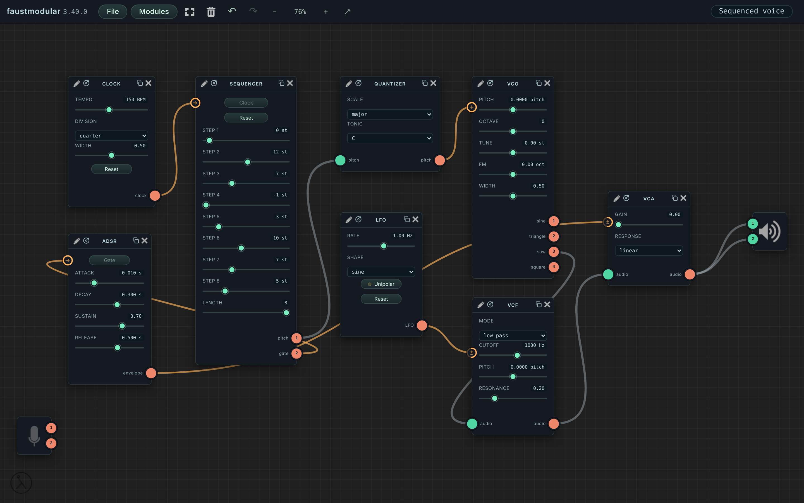

Each module is a small Faust program: oscillators, filters, envelopes, sequencers, effects, reverbs,
physical models… Connect them with cables, channel by channel, modulate any setting by any signal, and
open the code of a module to change it, or write your own. Everything is compiled in the browser.

---

- [First steps](#first-steps)
- [Modules](#modules)
- [Cables](#cables)
- [Modulation](#modulation)
- [The interface of a module](#the-interface-of-a-module)
- [Writing your own modules](#writing-your-own-modules)
- [Large patches](#large-patches)
- [Sound](#sound)
- [Scenes and files](#scenes-and-files)
- [Keyboard and mouse](#keyboard-and-mouse)
- [More](#more)

---

## First steps

The first time you open faustmodular, a sine oscillator is already connected to the speakers: press its
**gate** button to hear it. The microphone (on the left) and the speakers (on the right) are modules too.

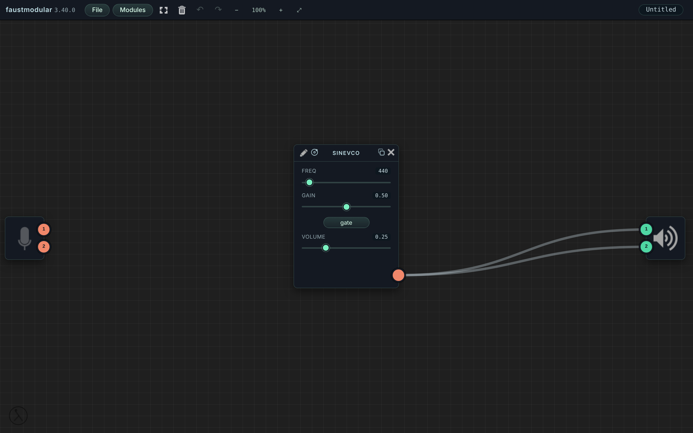

Then open the **Modules** menu, add a few modules, and connect them.

## Modules

The **Modules** menu holds more than 200 modules, in families:

- **Modular**: the building blocks of a modular synthesizer (VCO, VCF, VCA, ADSR, LFO, Clock, Sequencer,
  Quantizer, Mixer, MIDI to CV…), with common conventions: audio in [-1, 1], pitch 0.1 per octave, gates 0/1;
- **FaustPlayground**: harps, winds, bars and bowls, instruments with reverb, filters, echoes…;
- **Faust libraries**: reverbs (Zita, JPverb, Greyhole…), compressors, the Moog filter, equalizers, guitar
  pedals, saturation, delays, drums, physical models (flute, violin, bells…), analyzers;
- **My modules**: the modules you wrote or changed.

**Type to search**: the field is ready as soon as the menu opens. ↑ ↓ choose a module (its description is
shown on the right), **Enter** adds it. Double click or drag a module to add it too.

To play from a **MIDI keyboard**, add the **MIDI to CV** module (Chrome, Edge, Firefox): drop its *pitch* on the
Pitch of a VCO and its *gate* on the Gate of an ADSR. It also gives the velocity, the modulation wheel and the
aftertouch, and adds the pitch bend; one note at a time, on one channel or all. To play in time with a drum machine,
a hardware sequencer or a DAW, the **MIDI Clock** module follows its MIDI clock: a gate per sixteenth note (or
eighth, quarter, bar) for a Sequencer, a reset at Start, and the tempo it measures.

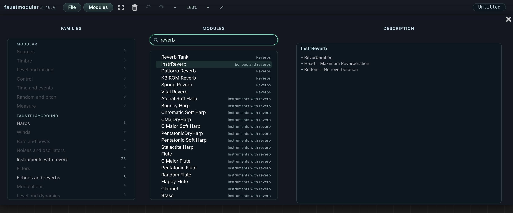

## Cables

Each module has one port per channel: inputs in green on the left, outputs in coral on the right.

- **Drag** from a port to a port of the other kind to connect them, or onto the **body** of a module to connect
  all the channels at once (stereo to stereo, mono to both sides…).
- **Click a cable** to delete it.
- **Click an output** (without dragging) to send it to the speakers, or to unplug it, without drawing a cable
  across the whole patch.

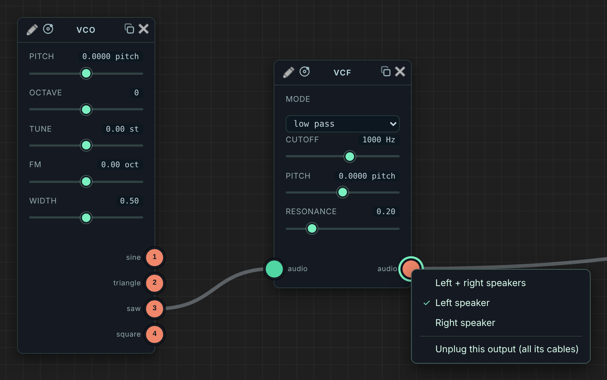

Cables may form loops: a cable that closes a cycle is dashed, and delayed by a short buffer.

## Modulation

Drop a cable **on a slider, a knob or a button** instead of a port: the signal now drives that setting. A
small round port appears on the left of the setting, with a sign for the way the signal acts on it (± around
its value, + added, ~ frequency modulation, ⇐ drives it) and a ring for the depth: **drag it vertically** to
change the depth.

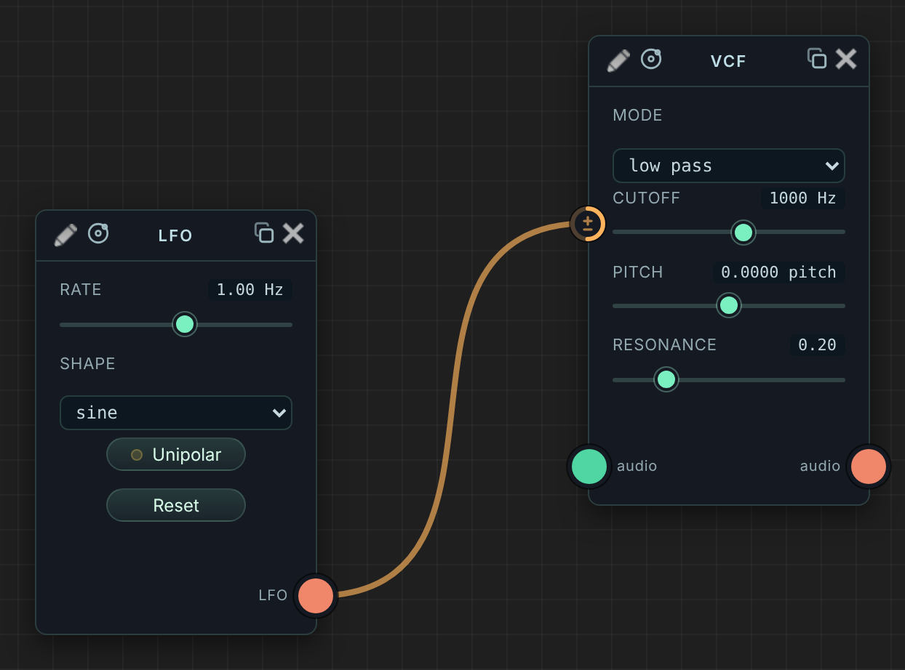

## The interface of a module

The settings of a module are laid out as its Faust code describes them: groups, rows, tabs, sliders, knobs,
buttons, checkboxes, menus and meters.

- **Double click a value** to type it.
- Drag a knob vertically (Shift: finer).
- Right click a module for its menu: copy, duplicate, minimize, unplug, delete…

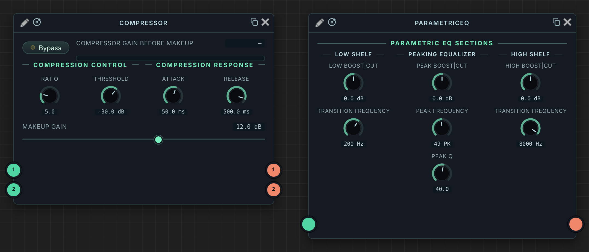

The **◎** button of the title bar shows the settings of a module as an **Orbit**
([faust-orbit-ui](https://github.com/orlarey/faust-orbit-ui)): each setting is a point around a centre, its value
set by its distance to the centre; moving the centre moves them all, and random variations or presets are one
click away.

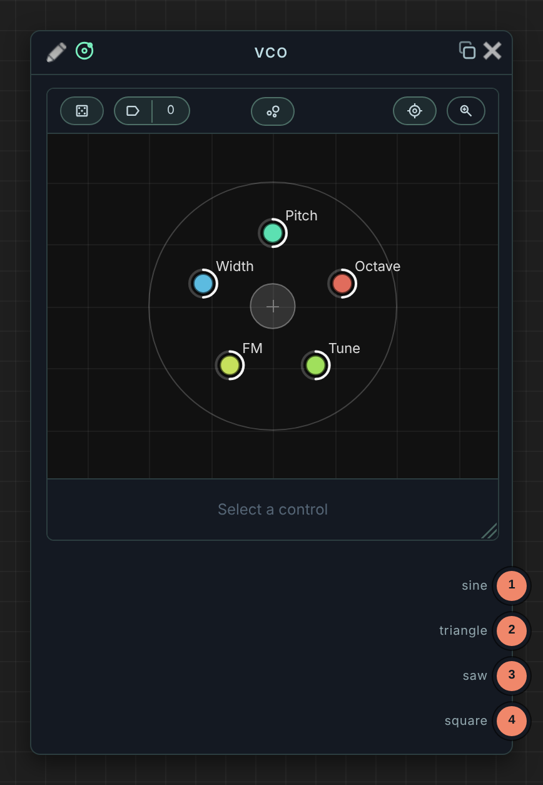

## Writing your own modules

The **✎** pencil of a module opens its code in [faustcode](https://orlarey.github.io/faustcode/), the Faust
editor in the browser. Each time you save there (Ctrl/Cmd-S), the module is updated in place, with its settings,
cables and modulations. A changed module is kept in **My modules**.

You can also:

- right click the stage and choose **New module**: an empty module, opened in faustcode to be written;
- open a program you edit in faustcode directly in faustmodular, with its **faustmodular** button;
- **import a Faust file** (.dsp) from the File menu, or drop it on the stage.

## Large patches

- **Zoom** with Ctrl/Cmd + the wheel (or a pinch), move with the wheel; ⤢ fits the whole patch in the window.
- Zoomed out, the module under the pointer is **magnified** to its real size: you can read and play it without
  zooming in. While you draw a cable, it lets you aim at a precise setting.
- Modules snap to the **edges and centres** of the others while you move them (Alt: no snapping).
- Drag a rectangle on the empty stage, or Shift-click, to select several modules.
- **Undo** anything with Ctrl/Cmd-Z.

<table><tr>
<td>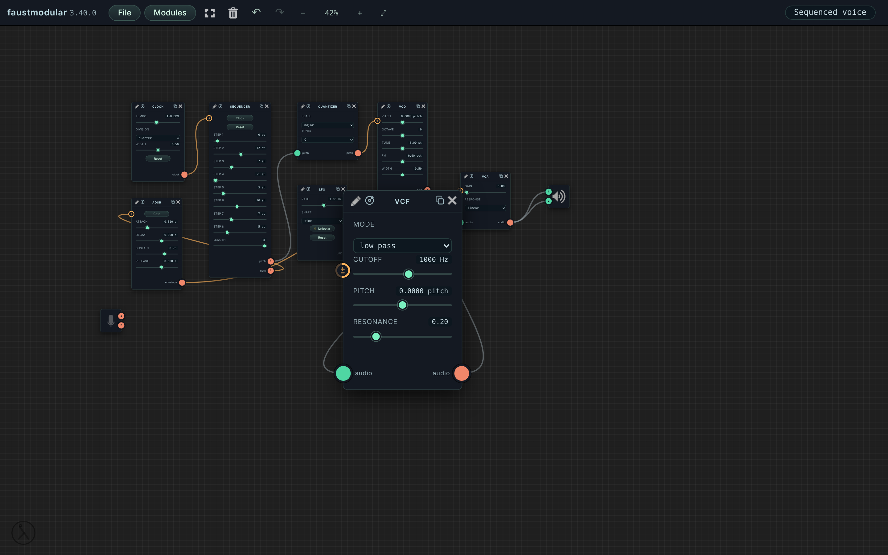</td>
<td width="150">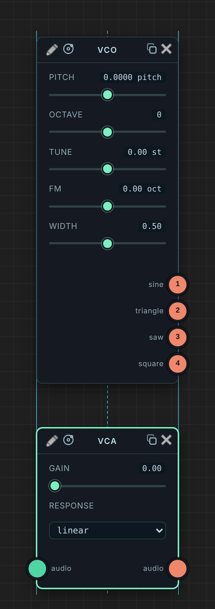</td>
</tr></table>

## Sound

The **speaker** module sets the volume of the whole scene: drag it vertically, and its brightness shows the
volume. Double click it to mute. A safety limiter protects your ears and speakers from a patch that runs wild
(the speaker glows while it acts).

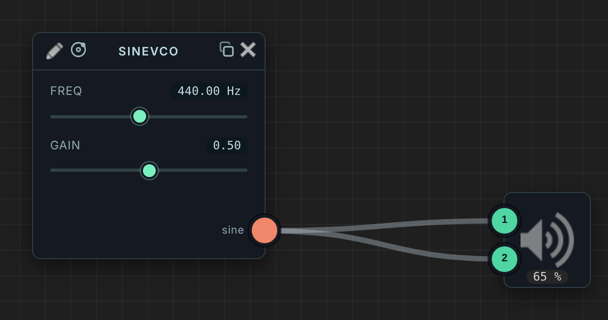

The microphone is only requested when you use it: when you connect a cable from it, or click it. It is closed when
the last cable from it is removed, or by a click on it when no cable leaves it.

## Playing in time with other tabs

The **transport** of the toolbar (⏮, ▶ / ■, the tempo, *bar:beat*) drives a timeline shared by the Faust
applications open in the browser (faust-sync): open faustmodular in two tabs, press ▶ in either, and both play;
change the tempo in one, the other follows. The **Sync Clock** module (*Modular* library) turns that timeline into
gates for a Sequencer: a gate per sixteenth note (or eighth, quarter, bar), aligned on the bar, a reset when the
playing starts from the beginning, and *run*. On one sound card, the gates of the two tabs come out at the same
sample: the position is counted in audio samples, not with timers (see
[the specification](Documentation/FAUST-SYNC-SPEC.md)).

## Scenes and files

Your scene is saved in the browser as you work, and opened again at your next visit. The **File** menu works as
in a desktop application: new scene, open, save (Ctrl/Cmd-S writes the same file again in Chrome and Edge), save
as, recent scenes and examples. Scenes are `.jfaust` files.

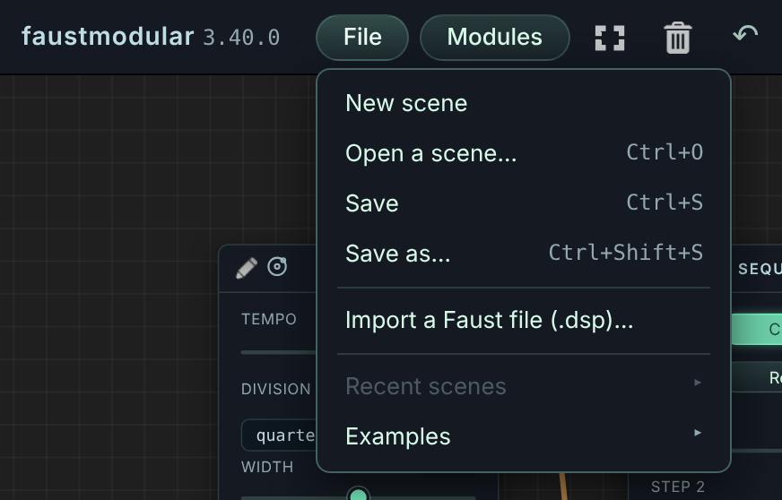

## Stores

A **store** is a GitHub repository of Faust modules and scenes, with a simple layout (`fauststore.json`,
`modules/<Name>/<Name>.dsp`, `scenes/<Name>/<Name>.jfaust`; a model in [`templates/fauststore`](templates/fauststore),
the specification in [`Documentation/STORE-SPEC.md`](Documentation/STORE-SPEC.md)). A public store is read without an
account:

- in the Modules menu, *Stores*, *Add a store…*: type `owner/repository`. Its modules are in the library, found by the
  search, added like the others; its scenes are in File ▸ Open from a store;
- a link opens a scene of a store as a new scene: put the address of its file on GitHub after `?scene=`,
  `https://orlarey.github.io/faustmodular/?scene=https://github.com/<owner>/<repository>/blob/main/scenes/<Name>/<Name>.jfaust`
  (or `?store=<owner>/<repository>&scene=scenes/<Name>/<Name>.jfaust`).

**Publishing** to your store: File ▸ *My store…*: the repository, and a token made on GitHub (a fine-grained token,
for that repository only, with the permission Contents read and write; it stays in your browser and is only sent to
GitHub). Then File ▸ *Publish the scene to my store*, or *Publish to my store* in the context menu of a module: one
commit each, and the link to share the scene, at that version, is copied.

## Keyboard and mouse

| | |
|---|---|
| Add a module | Modules menu: type, ↑ ↓, Enter; or double click, drag |
| Connect | drag from a port to a port, or onto a module |
| Modulate a setting | drag from an output onto the setting |
| To the speakers | click an output |
| Delete a cable | click it |
| Type a value | double click it |
| Depth of a modulation | drag its port vertically (Shift: finer; double click: default) |
| Volume / mute | drag the speaker vertically / double click it |
| Zoom / move | Ctrl/Cmd + wheel, pinch / wheel |
| Select | rectangle on the stage, Shift-click |
| Move without snapping | Alt while dragging |
| Undo / redo | Ctrl/Cmd-Z / Ctrl/Cmd-Shift-Z |
| Copy, cut, paste, duplicate | Ctrl/Cmd-C, X, V, D |
| Delete the selection | Delete |
| Save / save as / open | Ctrl/Cmd-S / Ctrl/Cmd-Shift-S / Ctrl/Cmd-O |

## More

- The [reference manual](Documentation/REFERENCE.md): every feature in detail, and the development notes
  (`npm install`, `npm run dev`, `npm test`).
- The [modular library](Documentation/MODULAR-LIBRARY.md) and its conventions.
- What changed: the [changelog](CHANGELOG.md).
- The Faust language: [faust.grame.fr](https://faust.grame.fr), and its [documentation](https://faustdoc.grame.fr).

faustmodular was born as an extension of [FaustPlayground](https://faustplayground.grame.fr), a Web platform
designed by [GRAME](https://www.grame.fr) to teach audio programming to children. It is written by Yann Orlarey:
the λ seal in the corner of the application leads here.

The screenshots of this page are made by `npm run screenshots`.
